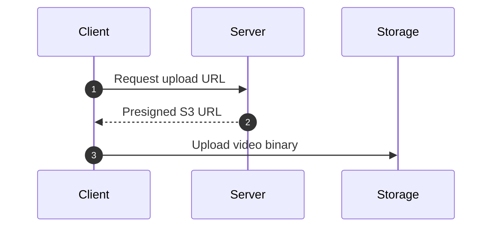

# merpako 🫧

> **"Mermaid diagrams, everywhere."**

Transform raw Mermaid code blocks in Markdown files into clickable SVG diagrams with interactive [mermaid.live](https://mermaid.live) editor links and collapsible source code.

[](https://nodejs.org/)
[](https://opensource.org/licenses/MIT)
[](package.json)

---

## 🌟 Why merpako?

Mermaid diagrams are the de facto standard for technical architecture, sequence diagrams, and state machines in developer documentation. However, viewing Mermaid diagrams typically requires browser extensions, dedicated IDE plugins, or platforms with built-in Mermaid renderers.

**merpako** solves this:
- **Zero Runtime Dependencies**: Built entirely on Node.js built-ins (`node:zlib`, `node:fs`, `fetch`).
- **Blazing Fast**: Sub-millisecond local processing (~0.18ms per document).
- **Clickable & Interactive**: Diagrams render as crisp SVGs and open the live [mermaid.live](https://mermaid.live) editor when clicked.
- **Collapsible Source Preserved**: The original Mermaid source is safely stored inside an HTML `<details>` block, so developers can still inspect, copy, or edit the source.
- **100% Reversible**: Use `--revert` at any time to restore your Markdown files back to standard Mermaid code fences.
- **Offline-First & CI-Ready**: Zero dependencies, idempotence checks, and a strict `--check` mode for CI pipelines.
- **Local Download Mode**: Save rendered SVGs locally in `assets/diagrams/` for air-gapped repositories or offline browsing.

---

## 📦 Installation

### Global Install
```bash
npm install -g merpako
```

### Run via npx (No Installation Needed)
```bash
npx merpako README.md
```

### Local Project Dependency
```bash
npm install --save-dev merpako
```

Add to your `package.json` scripts:
```json
{
  "scripts": {
    "diagrams": "merpako .",
    "diagrams:check": "merpako --check .",
    "diagrams:watch": "merpako --watch ."
  }
}
```

---

## 🚀 Quick Start

### 1. Transform a Single Markdown File
```bash
merpako README.md
```

### 2. Recursively Process All Markdown Files
```bash
merpako .
```

### 3. Expand Quoted Glob Patterns Internally
```bash
merpako "**/*.md"
```

### 4. Download SVGs Locally
```bash
merpako --download README.md
```

### 5. Custom Output Directory for Downloads
```bash
merpako --download ./output docs/
```

### 6. Watch Mode (Auto-Recompile on Save)
```bash
merpako --watch .
```

### 7. Revert Back to Raw Fences
```bash
merpako --revert README.md
```

### 8. CI Verification Mode
```bash
merpako --check .
```

---

## 🔄 Before & After Transformation

### Before (`README.md`)
````markdown
### Diagram: Video Upload Flow


````

### After (`merpako README.md`)
````markdown
### Diagram: Video Upload Flow

<!-- merpako:start -->
[(https://mermaid.live/edit#pako:eNqNUstqwzAQ_BWhkwv1B5xLQggk5NCSG2xLwY9tVRtLlgz2qSn4710r11DIIZfRnZ1hZj1A9pSgl-D3s3XggqJ1K_24gqGj2F9zU1y9l1mZl2p-1W8W3x-v07qg_Wk5wHlV7qN_0N4_OygdDNBb6R1bS...)

<details>
<summary><b>View Mermaid Source</b></summary>


</details>
<!-- merpako:end -->
````

---

## 🛠️ CLI Reference

```text
merpako 🫧 — Mermaid diagrams, everywhere.

USAGE:
  merpako [options] <files-or-directories...>

COMMANDS & EXAMPLES:
  merpako README.md                Transform one Markdown file (inline mode)
  merpako .                        Recursively transform Markdown files in current directory
  merpako "**/*.md"                Transform all Markdown files matching glob pattern
  merpako --inline README.md       Replace Mermaid code blocks with remote clickable SVGs
  merpako --download README.md     Download rendered SVGs locally to ./assets/diagrams/
  merpako --download ./out docs/   Save diagrams under custom root (./out/assets/diagrams/)
  merpako --revert README.md       Restore generated diagrams back to raw Mermaid fences
  merpako --check .                CI mode: fail with exit code 1 if raw diagrams exist
  merpako --watch .                Watch target directory and auto-transform on change

OPTIONS:
  -i, --inline                     Embed clickable SVG links using mermaid.ink (default)
  -d, --download [dir]             Download SVGs locally to assets/diagrams/ (or [dir])
  -o, --output <dir>               Custom output root directory for downloaded SVGs
  -r, --revert                     Revert merpako blocks back to raw Mermaid source
  -c, --check                      CI mode: check for unprocessed Mermaid diagrams
  -w, --watch                      Watch target directories and reprocess changed files
  -v, --version                    Display version number
  -h, --help                       Show this help message

EXIT CODES:
  0    Success / check passed
  1    Error encountered / unprocessed diagrams found in check mode
```

---

## 🧩 Deep Dive: Features & Behavior

### 1. Title Resolution Precedence
Titles for diagrams are resolved automatically in this order:
1. **Nearby Markdown heading**: e.g. `### Diagram: Video Upload Flow` or `## Architecture Overview`.
2. **Explicit Mermaid directive**:
   - YAML frontmatter:
     ```yaml
     ---
     title: Video Upload Flow
     ---
     ```
   - Top-level `title` or `accTitle` statement: `title Video Upload Flow`.
3. **Deterministic fallback**: `Diagram 1`, `Diagram 2`, etc.

Titles are properly escaped for Markdown image labels (`\[` and `\]`) and sanitized for HTML.

### 2. Markdown Fence Support
- Backtick fences: ```` ```mermaid ```` and ```` ````mermaid ````
- Tilde fences: `~~~mermaid` and `~~~~mermaid`
- Indented fences: 0 to 3 spaces indentation (per CommonMark)
- CRLF and LF line endings preserved accurately
- Non-Mermaid code fences (e.g. JavaScript, Python, Bash) are strictly ignored

### 3. Local SVG Downloads (`--download`)
When `--download` is enabled:
- Diagrams are fetched from `mermaid.ink` using the computed pako hash.
- Saved under `assets/diagrams/` in the output root (default: current directory).
- Deterministic, filesystem-safe filenames with content hashes (`<file>-<title>-<hash>.svg`) prevent naming collisions.
- Calculates accurate relative paths with portable forward slashes (`/`).
- Skips redundant network downloads if a valid matching SVG already exists locally.
- *Note: Download mode requires an active Internet connection to reach mermaid.ink.*

### 4. Watch Mode (`--watch`)
- Uses Node.js native filesystem watching with a reliable cross-platform directory traversal strategy.
- Debounces file changes (250ms) to accommodate rapid editor saves.
- Automatically ignores editor temporary files (`.swp`, `~`, `.tmp`, `4913`).
- Tracks written files to prevent infinite reprocessing loops.
- Gracefully handles file renames and deletions without terminating the session.
- Clean shutdown on `Ctrl+C` (`SIGINT` / `SIGTERM`).

### 5. Reversion Mode (`--revert`)
- Safely extracts the original diagram source from the collapsible `<details>` block.
- Restores the exact raw ```` ```mermaid ```` code fence.
- Preserves surrounding Markdown, indentation, whitespace, and line endings.

### 6. Continuous Integration (`--check`)
In CI/CD environments, verify that all Mermaid diagrams in your repository have been transformed:
```bash
merpako --check .
```
- **Exit Code 0**: All Mermaid blocks are processed, or no Mermaid blocks exist.
- **Exit Code 1**: Raw, unprocessed Mermaid blocks were detected. Details are printed with filenames and diagram counts.
- **Never modifies files in check mode.**

---

## 🤖 GitHub Actions Workflow

Add this workflow to `.github/workflows/diagrams.yml` to automatically verify or update diagrams:

```yaml
name: Verify Diagrams

on:
  push:
    branches: [main]
  pull_request:
    branches: [main]

jobs:
  check-diagrams:
    runs-on: ubuntu-latest
    steps:
      - name: Checkout repository
        uses: actions/checkout@v4

      - name: Set up Node.js
        uses: actions/setup-node@v4
        with:
          node-version: 22.x

      - name: Verify all Mermaid diagrams are transformed
        run: npx merpako --check .
```

---

## 🔬 URL & Compression Architecture

Mermaid Live Editor (`mermaid.live`) and `mermaid.ink` use zlib Deflate compression formatted with Base64URL and prefixed with `pako:`.

The state payload structure:
```json
{
  "code": "graph TD;\n  A-->B;",
  "mermaid": {
    "theme": "default"
  }
}
```

Encoding pipeline:
1. **JSON Serialization**: `JSON.stringify(payload)`
2. **Deflate Compression**: `node:zlib.deflateSync(buffer, { level: 9 })`
3. **Base64URL Encoding**: `compressed.toString('base64url')`
4. **URL Prefixing**: Prepended with `pako:`

Target URL formats:
- **SVG**: `https://mermaid.ink/svg/pako:<HASH>`
- **Live Editor**: `https://mermaid.live/edit#pako:<HASH>`

---

## 🔒 Safety & Data Integrity

- **Atomic Writes**: Modified files are written via temporary files and renamed atomically, preventing file corruption if a process is interrupted.
- **Graceful Failure**: If downloading an SVG fails due to a network error or HTTP issue, the original Markdown file is left untouched.
- **Idempotence**: Running `merpako` repeatedly makes 0 modifications if diagrams have not changed.
- **Zero Runtime Dependencies**: No risk of supply-chain attacks or unexpected transitive dependency breakage.

---

## 💻 Programmatic API

`merpako` can also be imported into your Node.js projects:

```javascript
import {
  encodeMermaid,
  decodeMermaid,
  parseMarkdown,
  transformMarkdown,
  revertMarkdown
} from 'merpako';

// Encode a diagram
const { svgUrl, editorUrl } = encodeMermaid('graph TD; A-->B;');

// Transform markdown string
const { content, changed } = await transformMarkdown({
  content: '```mermaid\ngraph TD; A-->B;\n```',
  mode: 'inline'
});

// Revert markdown string
const { content: rawMarkdown } = revertMarkdown(content);
```

---

## 🧪 Development & Testing

```bash
# Clone repository
git clone https://github.com/divyanshmehta355/merpako.git
cd merpako

# Run unit tests (offline & deterministic)
npm test

# Run live integration test against mermaid.ink (requires internet)
npm run test:live

# Run benchmark
node test/bench.js

# Test package packaging
npm pack --dry-run
```

---

## 📄 License

[MIT](LICENSE) © [Divyansh Mehta](https://github.com/divyanshmehta355)
